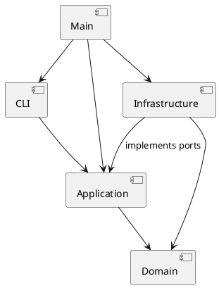

# PJ1 Phase 1：CLI SVG 编辑器

## 运行与演示

环境：Node.js 22+、npm。首次使用：

```sh
npm ci
npm run cli
```

交互示例：

```text
svg> init 800 600
canvas 800x600 created
svg> create g scene
g#scene created
svg> create rect r1 10 20 100 50 #4a90d9 in scene
rect#r1 created in g#scene
svg> create text title 25 50 "Hello SVG" in scene
text#title created in g#scene
svg> move scene 30 0
g#scene moved by (30,0)
svg> undo
undone: g#scene moved by (30,0)
svg> save demo.svg
saved to demo.svg (3 elements)
```

`undone:` 后描述的是被撤销的原命令；通过 `tree` / `show` 查看恢复后的状态。Ctrl+D 结束输入；Windows 也可 Ctrl+Z 后回车；Ctrl+C 退出。

执行课程两节点流程图示例，生成可直接用浏览器打开的 SVG：

```sh
npm run cli -- --script examples/flowchart.txt
```


文件参数包含空格时使用双引号，例如 `read "my drawings/demo.svg"`。脚本支持空行和以 `#` 开头的注释行；颜色中的 `#` 保留。引号内 `\"` 表示双引号、`\\` 表示反斜杠，其他反斜杠保留，适用于 Windows 文件路径。`in` 子句必须位于 create 末尾，且关键字不能加引号。

也可以从标准输入回放命令。交互模式显示 `svg> `，批处理模式不显示提示符；错误写入 stderr，其他输出写入 stdout。批处理遇错继续执行后续命令，最终以退出码 1 表示存在失败；全部成功时为 0。

```sh
npm run check
npm run build
node dist/src/main.js --script examples/flowchart.txt
```

命令速查（create 的各图形参数可执行 help 查看）：

| 命令 | 语法 |
| --- | --- |
| 新建 / 读取 / 保存 | `init [w] [h]`、`read <file.svg>`、`save [file.svg]` |
| 画布 | `canvas` 查询；`canvas <w> <h>` 修改 |
| 创建 | `create <type> <id> [params...] [in <containerId>]` |
| 删除 / 移动 / 缩放 | `delete <id>`、`move <id> <dx> <dy>`、`scale <id> <factor>` |
| 属性 | `set <id> <attr> <value>` |
| 组合 / 解组 | `group <newGid> <id1> [id2...]`、`ungroup <gid>` |
| 移入容器 | `addto <gid> <id>` |
| 绘制顺序 | `front <id>`、`back <id>` |
| 显示 / 帮助 | `tree [id]`、`show <id>`、`help` |
| 历史 | `undo`、`redo` |

## 架构方案

采用 TypeScript、面向对象、一类一文件。领域对象封装属性及操作，不将图形建模为公共数据袋。

| 模块 | 职责 |
| --- | --- |
| `src/domain` | SvgDocument 管理画布与树；ShapeFactory 创建六种内置图形；SvgValue 校验数据；不依赖 Node.js I/O |
| `src/domain/shapes` | Shape 抽象与 Rect、Circle、Ellipse、Line、Text、Group 类，封装属性、变换和深拷贝 |
| `src/application` | EditorSession 会话与事务、CommandDispatcher 分发、CommandHistory 与 HistoryEntry 历史、DocumentView 显示 |
| `src/application/commands` | 一条命令一个类，编辑类共享 EditCommand 的执行模板 |
| `src/application/ports` | FileStore 和 SvgCodec 接口，隔离磁盘和 XML 实现 |
| `src/cli` | 引号感知的分词、REPL、终端输出 |
| `src/infrastructure` | XML 编解码及文件系统适配 |
| `src/main.ts` | 组合根，注入具体适配器 |
| `tests` | 领域、命令、I/O、实际 CLI、典型会话和架构约束测试 |
| `examples` | 可回放的流程图脚本、生成结果和课程外部 SVG 样例 |



### 设计模式与依赖规则

- **Command，必需**：`commands/Command.ts` 定义执行接口；CreateCommand、MoveCommand 等封装每个请求；CommandDispatcher 根据命令名取得对象后调用 execute。EditCommand 将所有编辑统一交给 EditorSession.edit，一次成功调用产生一个历史单元。
- **Composite**：`shapes/Shape.ts` 提供 move、scale、set、clone、children 等统一接口。各叶子实现自身移动；Group 递归调用孩子的 move/scale。删除时 SvgDocument 摘除整个节点，容器的子树自然一同删除；公共样式 set 到 Group 本身，由 SVG 继承语义生效。
- **Memento**：`HistoryEntry.ts` 保存编辑前后独立深拷贝，`CommandHistory.ts` 管理两个栈。undo/redo 恢复快照，而非逆向浮点运算，也不重放磁盘 I/O。这样跨父分组、删除、顺序和属性均能准确恢复。
- **Factory**：`ShapeFactory.ts` 集中 CLI 创建及 XML 导入的图形类型分派；其他操作依赖多态，不按 tag 名重复分派。

编辑事务顺序：读取当前文档 → 深拷贝候选文档 → 在候选上执行和校验 → 创建历史快照 → 发布候选。任何失败都不会替换当前文档、修改历史或清空 redo。保存采用同目录临时文件写入后 rename 的方式；只有写入成功才更新当前文件路径并阻断历史。

依赖方向规则：

| 来源 | 允许依赖 | 理由 |
| --- | --- | --- |
| domain | domain 内部 | 核心规则可独立测试，不耦合终端、XML 或存储 |
| application | application、domain | 编排用例，通过端口请求外部能力 |
| cli | cli、application、Node.js 终端/流 API | 仅适配输入输出，不直接修改图形树 |
| infrastructure | infrastructure、application/ports、domain、Node.js/XML 库 | 实现外部适配，不反向控制应用流程 |
| main.ts | 所有生产模块 | 唯一组合根，选择具体适配器 |

命令名称分派 `CommandDispatcher` 和图形类型分派 `ShapeFactory` 是本阶段仅有的两处名称分派，也是明确的**待重构点**。后续有插件需求时，将内置注册替换为 provider 注入及插件发现；本阶段不声称实现了插件系统。属性白名单检查与 XML 节点种类检查属于数据校验，不承担图形名称到操作实现的分派。

### 变化点假设

1. 新增交互渠道：application 不读取标准输入，未来 GUI 可复用命令和领域对象。
2. 新增图形：保留 Shape 多态边界，工厂集中扩展；暂不承诺零内核修改的插件化。
3. 文件存储或 XML 库更换：以 application/ports 隔离。
4. 历史数据量：先用深快照降低恢复错误风险，未来大文档可替换为增量 Memento；本阶段不做持久化历史。

### 规则解释与修订记录

| 项目 | 最终决策与依据 |
| --- | --- |
| group 收入顺序 | 保持原文档深度优先遍历顺序，不因参数倒序而颠倒原图形顺序 |
| group 新容器的位置 | 说明未规定跨父场景的目标父级：选择最早被选节点的原父容器及原位置，其他节点从各自父容器摘出；测试固定此规则 |
| front / back | SVG 后出现的节点绘制在上层，因此 front 移到同级末尾，back 移到同级开头 |
| ungroup | 严格遵循课程限制：SVG 直接子容器禁止解组；嵌套容器的孩子替换该容器原位置 |
| scale | 所有几何属性，包括坐标和尺寸，乘同一正系数；不自动修改 stroke-width、font-size 或文本内容 |
| 历史屏障 | init/read/save、canvas 改尺寸成功后清空两个栈并阻断；下一次成功编辑重新开放；失败命令、查询和显示不触发屏障 |
| 无参 save | 保存到最近一次成功 read/save 的路径；init 清除路径，没有可用路径时报错 |
| 初始化前 help | 作为帮助入口允许执行；其他依赖文档的有效命令提示先 init/read |
| canvas 改尺寸 | 同时将 viewBox 设为 `0 0 w h`；不修改已有图形的几何属性 |
| 架构调整 | 最初表格只列顶层模块，最终补充 shapes、commands、ports 子目录和职责；依赖方向未改变 |

## 过程记录

1. 用户提供课程说明并询问完成方式。AI 阅读 `phase_cli_1.md`，确认 TypeScript、Command、Composite、文档与 final 标签要求。
2. 用户提供空远程仓库并要求完成。开发前先写模块边界与分步实现基线，而后按领域、命令、I/O、验收逐步提交。
3. AI 自查发现不能把常见编辑器习惯套用到本作业：顶层容器禁止 ungroup；scale 要同时缩放位置和尺寸；save 成功后阻断历史。依据课程 4.2、4.3 节实现，并以命令和验收测试固定。
4. 分组可能跨多个父容器，简单把选中对象放到数组末尾会丢失原顺序。实现前先确定按原树遍历顺序收入，放在最早选中节点位置；实际测试使用倒序参数 `group merged d a`，确认组内顺序仍为 a、d，且一次 undo 恢复各自父级与位置。
5. AI 检查导入逻辑时识别了补 ID 的冲突问题：边读边生成 rect1，可能撞上文件后面已有的 rect1。改为预扫描全部显式 ID，再分配缺失 ID。嵌套样例验证了 rect2、rect1、rect3 的分配结果。
6. 对“失败不改变状态”不只检查参数错误，还构造容器缩放时第二个孩子发生数值溢出的场景。事务在候选副本上运行，确认第一个孩子的中途修改也被丢弃，且 undo 仍指向上一次成功编辑。
7. 初次 XML 类型检查发现库声明中的 localName 可为空；补充 tagName 后备。另一次自查把 show 的简单数值从带引号输出调整为 `x=1.5`，使属性展示更贴合课程示例，并补充断言。
8. 实际进程测试回放标准输入和带空格路径的脚本，确认错误进入 stderr、错误后仍继续、EOF 无换行也不丢最后一条命令。文件系统测试通过“目标为已有目录”构造保存失败，确认原内容保留且临时文件清理。
9. 生成 `examples/flowchart.svg` 后使用 Edge 无界面渲染，AI 查看截图，确认两个矩形、中文文字和连接线位置正确。视觉检查由 AI 完成，没有将其描述为用户或教师的人工审查。

以上为本次会话实际发生的开发与验证记录。用户负责提供作业说明、仓库及完成任务的授权；代码实现、自查、测试与此文档由 Codex 协助完成。文档不虚构用户对生成代码的逐条人工纠错。

对应的阶段提交：

| 提交 | 内容 |
| --- | --- |
| `ae06ebe` | 工程配置、课程原始说明、架构基线 |
| `cfe9a6e` | 多态图形与 Composite 文档树，4 项领域测试 |
| `9511d0c` | Command、事务、历史、参数解析；累计 9 项测试 |
| `ba963be` | SVG 读写、REPL、主入口及流程图；累计 15 项测试 |
| `ebc4144` | 实际 CLI、文件系统、典型会话、依赖约束；累计 23 项测试与 CI |

最终文档与验证结果由后续提交补齐，`final` 标签指向全部工作完成后的提交。完整历史以仓库 `git log --oneline` 为准。

## 一致性自查

### 模块划分

实际代码遵循 domain、application、cli、infrastructure 和 main 的方案。`shapes/`、`commands/` 和 `ports/` 是初始顶层模块的细分，已在上方职责表补全。没有引入未说明的插件系统、GUI 或数据库。

生产类按类名分文件；FileStore、SvgCodec 文件只声明端口接口。Token、DecodedSvg 等只作为边界传输结构，图形本身仍由具有行为的封装类实现。

### 依赖方向

抽样检查：

- `domain/shapes/Rect.ts` 只导入 Shape；Group 只导入 Shape 与 SvgValue。
- `application/EditorSession.ts` 依赖 SvgDocument、CommandHistory 及两个端口，不导入 fs 或 XML 库。
- `application/commands/MoveCommand.ts` 调用 Shape.move，不识别 rect/circle 等类型名。
- `cli/CommandLine.ts` 依赖 CommandDispatcher 和 Tokenizer，不依赖 domain 或 infrastructure。
- `infrastructure/XmlSvgCodec.ts` 依赖 SvgCodec 端口、领域对象和 XML 库。
- `main.ts` 实例化 FileSystemStore、XmlSvgCodec 并注入会话。

`tests/architecture.test.ts` 对全部生产 TypeScript 文件检查静态 import 的层间方向、适配器只依赖 application/ports、类名与文件名一致，以及没有散落的 switch 分派。该检查已通过；它是针对当前静态导入写法的回归约束，不声称是任意 TypeScript 程序的完整依赖证明。当前未发现违反已声明规则的依赖。

## 功能完整性和质量保证手段

### 功能验收矩阵

| 功能 | 实现及验证证据 |
| --- | --- |
| init/read/save/canvas | 默认画布、显式尺寸、最近路径保存、初始化清除路径、画布查询与修改、I/O 失败与历史屏障 |
| 六种图形 create | rect/circle/ellipse/line/text/g；必填 ID；可选样式；所有类型支持末尾 in 子句；未提供样式时不写属性 |
| move/scale | 各类几何属性计算、组递归、浮点与负坐标、正比例限制、溢出回滚；描边和文本不额外缩放 |
| set | 公共样式、各自几何白名单、文字内容；拒绝 id 和非白名单属性 |
| delete | 整棵子树删除；一次 undo 恢复内容、父级和顺序 |
| group/ungroup/addto | 跨父归组、保序、嵌套解组替换位置、移入末尾、环检测、祖孙同时入选拒绝、顶层禁止解组 |
| front/back | 同级绘制顺序调整；undo/redo 恢复顺序 |
| tree/show/help | 几何属性内联、子树显示、父级与属性明细、全部命令和类型语法 |
| undo/redo | 每条编辑命令一个单元、整体分组恢复、新编辑清 redo、显示跳过、文档命令屏障、失败保留历史 |
| ID 和 SVG 读写 | 大小写敏感、重复拒绝、预扫描补 ID 与警告、嵌套结构、七元素课程文件、中文/特殊字符/CDATA、语义往返 |
| CLI | svg> 提示符、注释、颜色、引号及转义、空文字、Windows 路径、EOF、脚本回放、统一单行 error 前缀 |

### 测试层次和实际结果

测试运行器为 Node.js 内置 `node:test`，使用 tsx 加载 TypeScript。无需额外测试框架。源码开启 strict、noUncheckedIndexedAccess 和 noImplicitOverride。

| 文件 | 验证重点 |
| --- | --- |
| `tests/domain.test.ts` | 图形多态、深拷贝、树结构与数据校验 |
| `tests/commands.test.ts` | 全部编辑的历史单元、失败不变、redo 分支、I/O 屏障、数值溢出 |
| `tests/xml.test.ts` | XML 严格解析、补 ID、全部类型往返、中文及特殊字符、不支持内容的明确拒绝 |
| `tests/files.test.ts` | 实际磁盘原子替换、失败清理、路径保持、保存和导入事务 |
| `tests/cli.test.ts` | 启动真实 Node 进程，回放 stdin 和脚本，检查 stdout/stderr 与退出码 |
| `tests/tokenizer.test.ts` | Windows 路径、引号转义、空参数与颜色 |
| `tests/acceptance.test.ts` | 课程典型会话、跨父分组、约定错误信息与完整状态恢复 |
| `tests/architecture.test.ts` | 模块依赖方向、一类一文件与分派约束 |

2026-10-25 在本地 Windows / Node.js 24.14.1 执行 `npm run check`：**类型检查通过，23 项测试全部通过，构建通过**。运行流程图脚本成功保存 8 元素 SVG；Edge 渲染截图检查通过。测试临时目录位于 `.tmp/`，清理前校验范围；依赖、构建产物和临时数据均不提交到仓库。

`.github/workflows/ci.yml` 对 Windows 和 Ubuntu 的 Node.js 22 环境执行 npm ci、完整检查及流程图脚本。提交 `ebc4144` 的[首次远程 CI](https://github.com/3189912517-dev/pj-1/actions/runs/40163604726)已完成：**Windows、Ubuntu 两个任务全部成功**，包括干净安装依赖、23 项测试、类型检查、构建和案例回放。后续运行可在 [GitHub Actions](https://github.com/3189912517-dev/pj-1/actions) 查看。

### 支持边界与后续改进

- Phase 1 内置六种图形，不实现 box 和插件加载；`create box` 按课程要求报 unknown shape type。
- SVG 导入支持这些图形的嵌套、无单位或 px 数值、简单 text/CDATA。根缺尺寸时优先采用 viewBox 的宽高，再使用默认值。保存结果是标准 SVG。
- 额外展示属性与 transform 会保留，但 set 仍严格执行课程白名单。编辑修改元素自身的几何属性；不会把导入的 transform、CSS 或继承样式烘焙到坐标中。对带变换或继承样式的外部 SVG 改变父级时，可能改变显示效果；本阶段未提供任意 SVG 的全局坐标重定位。
- 不支持的元素（例如 path、defs、style、tspan）、DOCTYPE、百分比几何值、错误 XML 和非法几何属性会明确报错，保留原文档；不会静默删掉这些元素后保存。XML 注释和格式空白不作为编辑数据保存。
- 历史采用整文档深快照，每次编辑时间与存储开销随元素数量增长；当前适用于课程规模文档。暂不支持大文档的增量历史或跨进程恢复。
- `npm run check` 与案例验证说明上述范围内的质量依据，不代表已实现 SVG 标准的所有特性。

## Git 提交与交付检查

仓库：[3189912517-dev/pj-1](https://github.com/3189912517-dev/pj-1)。开发按阶段真实提交并推送，没有在全部完成后伪造历史。

最终版本使用附注标签 `final`，同时推送主分支与标签。可检查：

```sh
git log --oneline --decorate
git show final --stat
git ls-remote origin refs/heads/main refs/tags/final refs/tags/final^{}
```

提交前确认代码、此文档、案例与测试均已入库，工作区干净。课程截止时间未在本次会话提供，实际提交时限需以课程通知为准。
