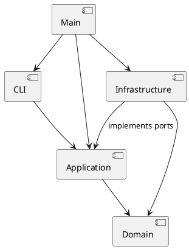

# PJ1 Phase 1：CLI SVG 编辑器

## 架构方案（开发前基线）

采用 TypeScript、面向对象、一类一文件。领域对象封装属性及操作，不将图形建模为公共数据袋。

| 模块 | 职责 |
| --- | --- |
| `src/domain` | SVG 文档、图形树、几何及结构约束；不依赖 Node.js I/O |
| `src/application` | 命令、会话、历史，以及文件与编解码端口 |
| `src/cli` | 引号感知的分词、REPL、终端输出 |
| `src/infrastructure` | XML 编解码及文件系统适配 |
| `src/main.ts` | 组合根，注入具体适配器 |

### 设计模式与依赖规则

- Command：每种命令独立成类，编辑命令统一经过事务与历史管理。
- Composite：Shape 的叶子与 Group 统一响应 move、scale、set 等操作；Group 递归操作孩子。
- Memento：编辑前后保存独立深拷贝，保证树结构、节点顺序和属性完整恢复。
- Factory：六种图形的名称分派集中在 ShapeFactory。
- 仅允许 CLI → application → domain；infrastructure 实现 application/ports 并依赖 domain；main 负责组装。domain 不反向依赖其他层。
- 命令名称分派与图形类型分派是两处明确的待重构点。后续有插件需求时演进为注册机制，Phase 1 不实现插件加载器或 box。

### 变化点假设

1. 新增交互渠道：application 不读取标准输入，未来 GUI 可复用命令和领域对象。
2. 新增图形：保留 Shape 多态边界，工厂集中扩展；暂不承诺零内核修改的插件化。
3. 文件存储或 XML 库更换：以 application/ports 隔离。
4. 历史数据量：先用深快照降低恢复错误风险，未来大文档可替换为增量 Memento；本阶段不做持久化历史。

## 过程记录

1. 用户提供课程说明并询问完成方式。AI 阅读 `phase_cli_1.md`，确认 TypeScript、Command、Composite、文档与 final 标签要求。
2. 用户提供空远程仓库并要求完成。开发前先写模块边界与分步实现基线，而后按领域、命令、I/O、验收逐步提交。
3. 自查时发现不能把常见编辑器习惯套用到本作业：顶层容器禁止 ungroup；scale 要同时缩放位置和尺寸；save 成功后阻断历史。这些规则将通过回归测试固定。

后续实际验证、修订与结果随实现追加；不将 AI 自动自查描述成人工审查。

## 一致性自查

待实现完成后依据实际目录和依赖检查填写。

## 功能完整性和质量保证手段

计划覆盖领域规则、编辑事务与历史、SVG 往返、CLI 典型会话。最终以实际测试结果填写验收表，不将计划视为已通过。
